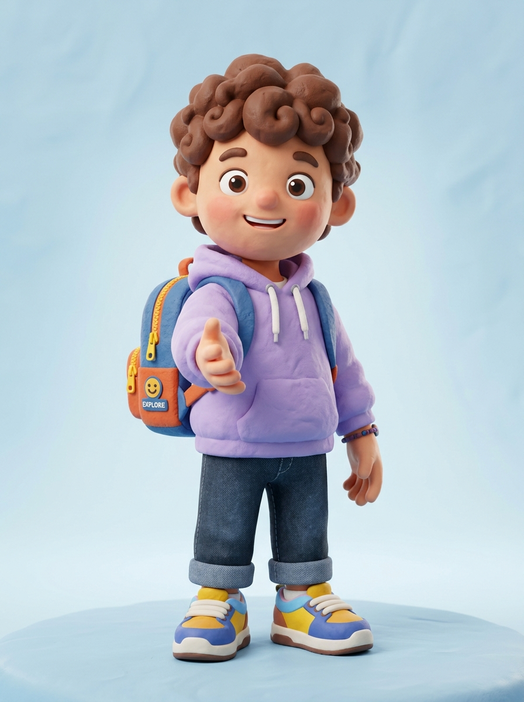
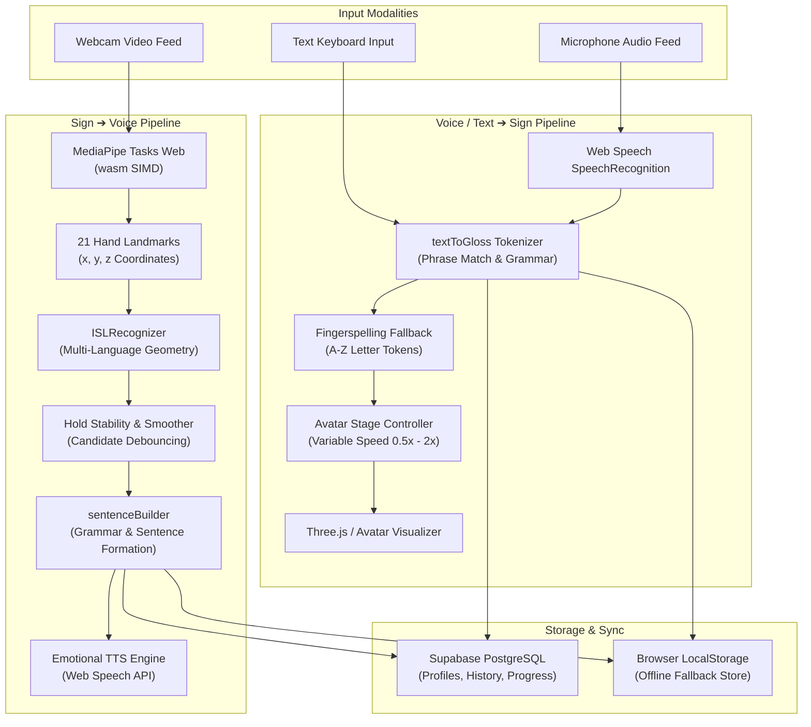

# Ishara (इशारा) — Real-Time Sign Language Translator (ISL + ASL)

<div align="center">



**An accessible, two-way sign language translation platform bridging communication between the Deaf/Hard-of-Hearing and hearing communities.**

[](https://react.dev/)
[](https://www.typescriptlang.org/)
[](https://vitejs.dev/)
[](https://tailwindcss.com/)
[](https://developers.google.com/mediapipe)
[](https://threejs.org/)
[](https://supabase.com/)
[](https://vercel.com/)

</div>

---

## 📌 Project Overview

**Ishara** (the Hindi word for *"gesture"* or *"sign"*) is an interactive, browser-based two-way sign language translation platform supporting **Indian Sign Language (ISL)** and **American Sign Language (ASL)**.

Built with a tactile, soft 3D **Claymorphism** design language, Ishara runs directly in modern web browsers with **client-side AI inference**—delivering zero-latency hand tracking and gesture recognition without sending private video feeds to external cloud servers.

### 🔄 Project Strategy Update
Following an architectural evaluation during development, the project pivoted from fragmented native mobile binaries to an **all-inclusive, responsive Web application**. The web platform delivers universal cross-device accessibility across desktops, laptops, tablets, and mobile browsers, removing installation friction while leveraging MediaPipe WebAssembly acceleration and Web Speech APIs.

---

## ✨ Core Features & Capabilities

```
  ┌────────────────────────────────────────────────────────────────────────┐
  │                           ISHARA WEB PLATFORM                          │
  ├────────────────────────────────────┬───────────────────────────────────┤
  │       🖐️ SIGN ➔ VOICE / TEXT       │       🗣️ VOICE / TEXT ➔ SIGN      │
  │  • Real-time webcam hand tracking  │  • Web Speech API speech-to-text  │
  │  • 21-landmark MediaPipe detection │  • NLP phrase & grammar tokenizer │
  │  • Multi-language ISL/ASL classifier│ • ISL/ASL dictionary matching    │
  │  • 20 recognized core signs        │  • Automated fingerspelling       │
  │  • Sentence formation engine       │  • Animated 3D Avatar stage       │
  │  • Hold-stability locking bar      │  • 0.5x - 2.0x playback speeds    │
  │  • Similar candidate probabilities │  • Step-by-step playback controls │
  │  • Multi-emotion TTS voice engine  │  • Interactive phrase strip       │
  └────────────────────────────────────┴───────────────────────────────────┘
```

### 1. 🖐️ Sign to Voice / Text Translation
- **Client-Side Vision**: Powered by Google MediaPipe Tasks Web (`@mediapipe/tasks-vision`) with local WebAssembly SIMD binaries bundled directly in `web/public/mediapipe/wasm/` (no external CDN dependency).
- **Multi-Language ISL & ASL Classifier**: Geometric landmark analysis across 21 3D hand coordinates with distinction between one-handed and two-handed gestures across Indian Sign Language (ISL) and American Sign Language (ASL).
- **Sentence Builder Engine**: Real-time sentence formation (`sentenceBuilder.ts`) that accumulates confirmed signs, cleans syntax, and generates natural spoken English sentences.
- **Hold Stability & Similar Candidates**: Integrated candidate debouncing with visual hold-stability progress bar, confirmation cooldown, and a live "Similar Glosses" telemetry card displaying relative candidate probabilities.
- **Emotional Voice Synthesis**: Powered by the Web Speech API with 4 selectable vocal intonations: **Neutral**, **Happy**, **Calm**, and **Excited**, featuring dynamic pitch and speech rate modulation.

### 2. 🗣️ Voice / Text to Sign Translation
- **Bimodal Speech & Text Input**: Transcribe live speech via the browser's speech recognition microphone stream or input custom text.
- **NLP Gloss Tokenizer**: Normalizes colloquial expressions, detects compound phrases (e.g., `GOOD MORNING`, `HOW ARE YOU`, `THANK YOU`), applies ISL/ASL grammar transformations, and falls back to character fingerspelling for unknown words.
- **Interactive Avatar Stage**: Visual avatar stage displaying sign gloss tokens, synchronized emoji representations, bounce animations, and full playback controls (Play, Pause, Step Next, Step Prev, Reset, and speed tuning from `0.5x` to `2.0x`).

### 3. 🎓 Interactive Learn Mode & Quizzes
- **Structured Curriculum**:
  - **Module 1 — Greetings & Basics**: `HELLO`, `GOOD_MORNING`, `THANK_YOU`, `PLEASE`, `SORRY`
  - **Module 2 — Daily Essentials**: `YES`, `NO`, `EAT`, `WATER`, `DRINK`, `HOME`, `HELP`
  - **Module 3 — Relationships & Social**: `FRIEND`, `LOVE`, `GOOD`, `BAD`, `HOW_ARE_YOU`
- **Interactive Practice & Quizzes**: Multiple-choice visual quizzes with instant answer feedback, streak tracking, and lesson progress synchronization.

### 4. 📜 Searchable Translation History & Export
- Chronological translation logs with direction labels (`Sign to Voice` vs `Voice to Sign`).
- One-click text-to-speech audio replay.
- Live keyword search and language filters (ISL / ASL).
- Export translation archives to **JSON** or **CSV** formats.

### 5. 🎨 Claymorphism Design System
- Tactile, friendly aesthetic inspired by soft modeling clay.
- Pastel color palette (Soft Blue, Coral, Mint Green, Lavender, Slate contrast text).
- Dual outer light/shadow highlights on cards and buttons; dual inset shadows on inputs and toggles.
- Standard 28px border radius (`rounded-[28px]`, `var(--clay-radius)`).
- Accessibility: WCAG AA contrast ratio (>= 4.5:1) with visible focus rings.

### 6. 🔐 Flexible Auth & Zero-Config Guest Mode
- Powered by `@supabase/supabase-js`.
- **Guest Access**: Explore the complete application instantly in 1 click without entering credentials.
- **Conditional Cloud Sync**: Automatically connects to Supabase when `VITE_SUPABASE_URL` and `VITE_SUPABASE_PUBLISHABLE_KEY` are provided; seamlessly falls back to persistent `localStorage` when offline or unconfigured.

### 7. 🛠️ Developer Pose & Rig Inspector
- Dedicated diagnostic screen at `/dev/pose` displaying real-time telemetry:
  - MediaPipe runtime status and hardware delegate (CPU / GPU)
  - Active landmark coordinates (21 hand coordinates + 33 pose markers)
  - Tensor input shape inspector (`[1, 64, 225] float32`)
  - Live FPS monitoring

---

## 🤟 Supported Signs & Vocabulary

Ishara's multi-language classifier recognizes 20 core signs across 4 categories:

| Gloss ID | Human Label | Category | Modality | Physical Gesture Description |
|---|---|---|---|---|
| `HELLO` | 👋 Hello | Greetings | Single Hand | Open palm temple salute (ISL) / forehead salute (ASL) |
| `THANK_YOU` | 🙏 Thank You | Greetings | Single Hand | Flat hand moving outward and down from chin |
| `PLEASE` | 🤲 Please | Greetings | Two-Handed | Folded palms Namaste (ISL) / circular chest rub (ASL) |
| `SORRY` | ✊ Sorry | Greetings | Single Hand | Closed fist rotating in circular motion on chest |
| `GOODBYE` | 🙋 Goodbye | Greetings | Single Hand | Open hand waving side-to-side horizontally |
| `HOW_ARE_YOU`| 🤝 How Are You| Greetings | Two-Handed | Two cupped palms opening outward |
| `YES` | 👍 Yes | Basic | Single Hand | Closed fist or thumbs-up nodding up and down vertically |
| `NO` | 🙅 No | Basic | Single Hand | Index finger wagging side-to-side (ISL) / snapping shut (ASL) |
| `GOOD` | 🤙 Good | Basic | Single Hand | Upright steady thumbs-up (ISL) / chin to palm drop (ASL) |
| `BAD` | 👎 Bad | Basic | Single Hand | Downward thumbs-down (ISL) / chin outward flip down (ASL) |
| `HELP` | 🆘 Help | Basic | Two-Handed | Closed fist resting on flat palm, lifting upward together |
| `STOP` | 🛑 Stop | Basic | Single Hand | Vertical open flat palm barrier facing forward |
| `EAT` | 🍽️ Eat | Needs | Single Hand | Bunched fingertips brought towards mouth |
| `DRINK` | 🥤 Drink | Needs | Single Hand | C-shape hand tilted toward mouth as if drinking |
| `WATER` | 💧 Water | Needs | Single Hand | Cupped hand (ISL) / W-handshape tapped against chin (ASL) |
| `FOOD` | 🍲 Food | Needs | Single Hand | Bunched fingertips tapping mouth/chin repeatedly |
| `HOME` | 🏡 Home | Social | Two-Handed | Two hands forming roof gable inverted "V" shape |
| `FRIEND` | 🧑‍🤝‍🧑 Friend | Social | Two-Handed | Clasped hands in front of chest (ISL) / interlocking hooks (ASL) |
| `NAME` | 🏷️ Name | Social | Single Hand | H/U shape tapping chest (ISL) / crossed H-fingers (ASL) |
| `LOVE` | ❤️ Love | Social | Single/Dual | Crossed wrists over chest or ILY (I-Love-You) sign |

---

## 🏗️ System Architecture



---

## 📂 Repository Structure

```
Ishara/
├── web/                           # Primary React + TypeScript + Vite Web Application
│   ├── public/                    # Static assets, local WASM, and ML models
│   │   ├── mediapipe/wasm/        # Offline MediaPipe WebAssembly binaries
│   │   ├── models/                # Local hand_landmarker.task model (7.8 MB)
│   │   ├── hero-character.jpg     # Hero artwork
│   │   └── login-character.jpg    # Login page artwork
│   ├── src/
│   │   ├── components/            # Claymorphic UI components
│   │   │   ├── AppLayout.tsx      # Main layout with header and navigation
│   │   │   ├── AvatarStage.tsx    # 3D Avatar stage and playback controls
│   │   │   ├── Header.tsx         # Header with language picker & auth pill
│   │   │   ├── Sidebar.tsx        # Claymorphic navigation sidebar
│   │   │   └── BottomTabBar.tsx   # Mobile-friendly bottom navigation bar
│   │   ├── context/               # React Context providers (AuthContext, ToastContext)
│   │   ├── data/                  # Lesson content (lessons.json) & store adapter (store.ts)
│   │   ├── lib/                   # Core business logic
│   │   │   ├── recognizer.ts      # Base recognizer abstractions & smoother
│   │   │   ├── speech.ts          # Emotional Web Speech API synthesis wrapper
│   │   │   ├── supabase.ts        # Conditional Supabase client initialiser
│   │   │   └── textToGloss.ts     # NLP parser, dictionary matcher & fingerspeller
│   │   ├── ml/                    # Machine Learning modules
│   │   │   ├── handTracker.ts     # MediaPipe HandLandmarker wrapper
│   │   │   ├── islClassifier.ts   # 20-sign multi-language geometric classifier
│   │   │   ├── sentenceBuilder.ts # Real-time sentence construction engine
│   │   │   └── demoRecognizer.ts  # Demo mode fallback recognizer
│   │   ├── pages/                 # Route page components
│   │   │   ├── LandingPage.tsx    # Showcase and feature portal
│   │   │   ├── DashboardPage.tsx  # Central hub, quick actions & streaks
│   │   │   ├── SignToVoicePage.tsx# Live webcam sign translation
│   │   │   ├── VoiceToSignPage.tsx# Speech-to-sign avatar player
│   │   │   ├── LearnPage.tsx      # Interactive curriculum and quizzes
│   │   │   ├── HistoryPage.tsx    # Searchable translation archive & export
│   │   │   ├── SettingsPage.tsx   # Language, speech, and theme preferences
│   │   │   ├── DevPosePage.tsx    # Landmark telemetry and tensor inspector
│   │   │   └── LoginPage.tsx      # Auth screen with 1-click Guest Mode
│   │   ├── store/                 # Zustand state management (useLanguageStore.ts)
│   │   ├── App.tsx                # Client-side router & lazy page loading
│   │   └── main.tsx               # Application entry point
│   ├── tailwind.config.js         # Claymorphism shadows, radii, and palette tokens
│   ├── tsconfig.json              # TypeScript strict configuration
│   ├── vite.config.ts             # Vite build pipeline
│   └── package.json               # NPM scripts and dependencies
├── design/                        # Claymorphism design system specifications
│   ├── tokens.css                 # CSS variable declarations for dual shadows & colors
│   └── tokens.json                # JSON design token specifications
├── assets/                        # Shared design and lesson assets
│   ├── avatar/                    # Avatar specifications & clip manifests
│   └── lessons/                   # Curriculum content specifications
├── backend/                       # Supabase database migrations, RLS policies, & tests
│   └── supabase/migrations/       # PostgreSQL schemas (profiles, history, progress)
├── ml/                            # Machine learning training scripts & label contracts
│   ├── models/                    # Model labels (labels_isl.json, labels_asl.json)
│   └── src/                       # Classifier training code
├── docs/                          # Architecture contracts and hackathon guidelines
├── vercel.json                    # Single-command Vercel production deployment spec
├── AGENTS.md                      # Team standards & operational guidelines
└── README.md                      # Master project documentation
```

> **Note on Architecture Evolution:** The `android/` directory contains legacy mobile prototypes created during the early hackathon phase. Per the updated strategy, all active development, features, and production deliverables are housed within the `web/` application.

---

## 🚀 Getting Started

### Prerequisites
- [Node.js](https://nodejs.org/) (v18.0.0 or higher recommended)
- [npm](https://www.npmjs.com/) (v9.0.0 or higher)
- A modern web browser with camera and microphone permissions enabled (Google Chrome, Microsoft Edge, Brave, or Safari).

### 1. Clone the Repository
```bash
git clone https://github.com/Dev-VardhanX/Ishara.git
cd Ishara
```

### 2. Install Web Dependencies
Navigate to the `web/` directory and install the packages:
```bash
cd web
npm install
```

### 3. Environment Configuration (Optional)
Ishara functions **100% out of the box** in offline/mock mode without requiring any credentials.

To optionally connect your own Supabase project:
```bash
cp .env.example .env
```
Populate `.env` with your project keys:
```env
VITE_SUPABASE_URL=https://your-project.supabase.co
VITE_SUPABASE_PUBLISHABLE_KEY=your-supabase-anon-key
```
*(Only client-safe `anon` / publishable keys are used; never expose service-role keys).*

### 4. Run the Development Server
```bash
npm run dev
```
Open your browser and navigate to `http://localhost:5173`.

### 5. Build for Production
To compile and bundle optimized production assets:
```bash
npm run build
```
To preview the production bundle locally:
```bash
npm run preview
```

---

## 🎨 Design System: Claymorphism

Ishara uses a tailored claymorphic interface designed to feel tactile, inviting, and approachable:

| Token / Property | Value / Hex Code | Usage |
|---|---|---|
| **Base Background** | `#E9EEF7` | Soft clay viewport backdrop |
| **Primary Pastel Blue** | `#7C9CFF` (`#8EA7E9`) | Primary buttons, active states, indicators |
| **Accent Pastel Coral** | `#FFB59E` (`#FF8A8A`) | Call-to-actions, recording buttons, highlights |
| **Success Pastel Green**| `#A8E6A1` (`#A0D995`) | Quizzes, confirmation badges, online indicators |
| **Accent Pastel Purple** | `#D4A5FF` (`#B39DDB`) | Learning modules, avatar stages |
| **High-Contrast Slate**| `#2B2D42` | Primary text and headings (WCAG AA compliant) |
| **Subtext Slate** | `#6E7387` | Secondary labels, descriptions, and captions |
| **Corner Radius** | `28px` (`rounded-[28px]`) | Applied uniformly across all cards and buttons |
| **Raised Card Shadow** | `8px 8px 16px rgba(150,165,195,0.55), -8px -8px 16px rgba(255,255,255,0.9)` | Raised clay depth |
| **Inset Input Shadow** | `inset 4px 4px 8px rgba(150,165,195,0.55), inset -4px -4px 8px rgba(255,255,255,0.9)` | Pressed buttons and text inputs |

---

## ☁️ Deployment

The project is pre-configured for zero-friction deployment on [Vercel](https://vercel.com/) via the root `vercel.json`:

```json
{
  "buildCommand": "cd web && npm run build",
  "outputDirectory": "web/dist",
  "rewrites": [{ "source": "/(.*)", "destination": "/index.html" }],
  "headers": [
    {
      "source": "/(.*)",
      "headers": [{ "key": "Permissions-Policy", "value": "camera=(self), microphone=(self)" }]
    }
  ]
}
```

Simply import the GitHub repository into your Vercel dashboard and click **Deploy**.

---

## 🛡️ Truth in Advertising & Hackathon Scope

In alignment with project ethics and standards:
- **Client-Side Processing**: MediaPipe hand landmark tracking and geometric classification execute entirely within the user's browser runtime.
- **Privacy by Design**: No video frames or camera feeds are ever transmitted to or stored on remote servers.
- **Honest Accuracy Metrics**: Ishara provides real-time assistive translation with an intuitive 20-sign vocabulary and stability smoothing suitable for everyday conversational bridges; it does not claim medical or legal certification.

---

<div align="center">

Built with ❤️ by the **Ishara Team**

</div>
